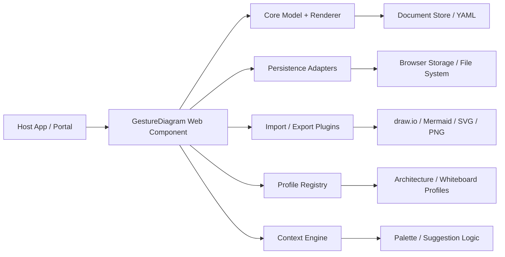

## Architecture Overview

### Design Principles
- Keep the document model stable, serializable, and adapter-agnostic.
- Keep rendering and gesture logic independent from UI framework dependencies.
- Prefer local-first editing and optional external integration over backend-first default behavior.
- Use pluggable interfaces for persistence, profiles, collaboration, and import/export.

## Components

### 1. Core engine
- **Purpose:** Own the canonical document model, shape semantics, geometry, connectors, and operation processing.
- **Responsibilities:**
  - Manage shape and edge state
  - Enforce invariants like valid containment and connector endpoints
  - Serialize and deserialize YAML
  - Expose undo/redo and change event streams
- **Technology:** TypeScript; headless runtime; no direct UI dependency

### 2. Renderer
- **Purpose:** Translate the document model into a visual representation.
- **Responsibilities:**
  - Pan/zoom viewport management
  - Spatial indexing and culling
  - Render shapes, text, layers, and connectors
  - Support overlays for selection, handles, and editor affordances
- **Technology:** Canvas 2D as default; DOM/SVG overlays for accessibility and interactive affordances

### 3. Gesture recognizer
- **Purpose:** Convert user strokes into semantic actions.
- **Responsibilities:**
  - Match strokes to supported shapes and connector gestures
  - Handle ambiguous detection and recovery paths
  - Surface alternatives in the contextual palette
- **Technology:** Geometry-based recognition with a benchmarked corpus and optional lightweight ML fallback

### 4. Context engine and palette
- **Purpose:** Suggest likely next actions based on the current state and recent patterns.
- **Responsibilities:**
  - Rank candidate actions and shape conversions
  - Manage style inheritance and palette results
  - Support model-specific and profile-specific recommendations
- **Technology:** Context-driven ranking function with explainability hooks

### 5. Profile registry
- **Purpose:** Provide domain-specific rules and libraries.
- **Responsibilities:**
  - Register supported diagram types such as architecture, flowchart, or whiteboard
  - Provide style tokens, vocabulary, and import/export mapping rules
- **Technology:** Plugin registry with typed interfaces

### 6. Persistence adapters
- **Purpose:** Persist, load, and restore diagram documents in host-selected ways.
- **Responsibilities:**
  - Store documents in browser storage or file systems
  - Expose a stable save/load contract
  - Allow future adapter expansion for server-backed storage
- **Technology:** Browser API adapters plus host-defined providers

### 7. Import/export plugins
- **Purpose:** Convert to and from external diagram formats.
- **Responsibilities:**
  - Parse supported formats
  - Produce a capability/loss matrix
  - Round-trip the model with explicit warnings where fidelity is limited
- **Technology:** Modular plugin architecture

### 8. Host integration layer
- **Purpose:** Offer a safe embedding surface to external environments.
- **Responsibilities:**
  - Provide web-component and React wrapper APIs
  - Expose configuration for theme, profile, and read-only mode
  - Emit events for load, save, selection, and change actions
- **Technology:** Web component + React bridge

## Architecture Decisions (ADRs)

### ADR-01: Client-first core with optional backend adapters
- **Date:** 2026-10-29
- **Status:** accepted
- **Context:** The project requires a fast, embeddable editor without forcing a backend in v1.
- **Decision:** The document model and editor core are client-side and framework-agnostic; server-backed integration is added through adapter interfaces when needed.
- **Consequences:**
  - Positive: simpler first release, lower operational burden, faster local feedback loop
  - Negative: collaboration and enterprise features remain intentionally delayed

### ADR-02: YAML as the native stored format
- **Date:** 2026-10-29
- **Status:** accepted
- **Context:** The project needs a readable, portable, versionable document model that remains easy to diff and author by hand.
- **Decision:** Store and load the canonical native diagram file as YAML, with JSON as an optional wire encoding of the same model.
- **Consequences:**
  - Positive: readable diffs, easier hand authoring, simpler review in repositories
  - Negative: parser/serializer discipline is required to avoid ambiguous YAML behavior

### ADR-03: Framework-agnostic core with UI wrappers
- **Date:** 2026-10-29
- **Status:** accepted
- **Context:** The product should integrate with various host environments without creating a framework lock-in.
- **Decision:** Build the core editor as framework-agnostic TypeScript and expose wrappers for web components and React.
- **Consequences:**
  - Positive: better embedding, stronger host compatibility, cleaner separation of concerns
  - Negative: additional integration work for each wrapper and host-specific edge cases

### ADR-04: Plug-in architecture for profiles, adapters, and import/export
- **Date:** 2026-10-29
- **Status:** accepted
- **Context:** The product needs to support multiple diagram types, persistence modes, and interoperability paths while avoiding a monolith.
- **Decision:** All major extension points must use typed, versioned interfaces; no hidden implementation coupling is allowed.
- **Consequences:**
  - Positive: modular growth and easier future extension
  - Negative: more initial interface design work and strict versioning rules

## Risks and Mitigations

- **Recognition accuracy risk:** address with a corpus, benchmark, and fallback flows for ambiguity.
- **Rendering performance risk:** address with culling, spatial indexing, and measured large-diagram benchmarks.
- **Overbroad architecture risk:** address by keeping the first release to the smallest plugin surface required for the demo and v1 value.

## Summary

The architecture is intentionally compact and modular. The product is built around a headless model, a rendering engine, a recognizer, and extension points for persistence, profiles, and interoperability. This provides a clean path for a first release, while staying open to future collaboration and server-backed features without forcing a backend in the initial product.
